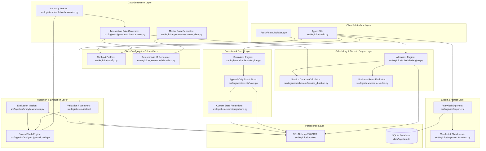
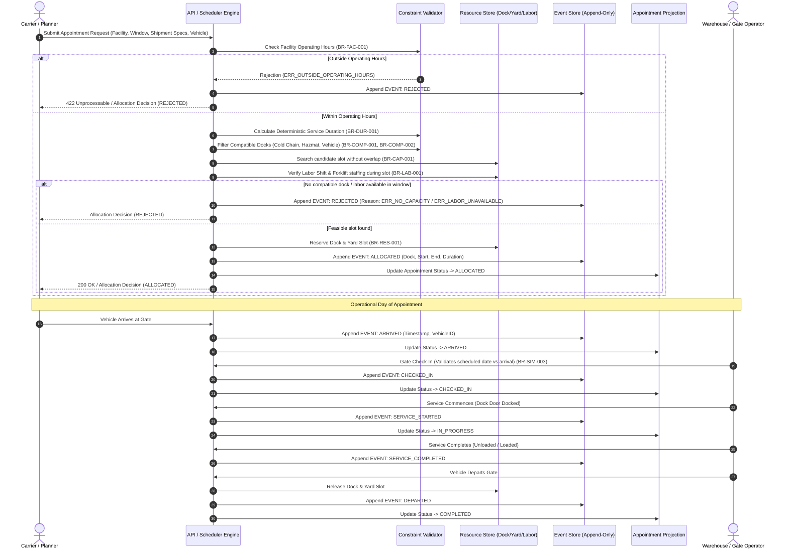

# Architecture Design Document
## Synthetic Logistics Appointment Scheduling Platform (YottaFlex AI)

---

## 1. Executive Summary & System Boundary

The **Synthetic Logistics Appointment Scheduling Platform** is a local, deterministic, high-throughput simulation and scheduling engine designed to model freight appointment allocation, operational execution, and exception handling across logistics facilities.

The platform coordinates multiple logistical constraints:
1. **Physical Facilities**: Operating hours, gate processing, dock doors, dock capabilities (cold storage, hazmat, standard).
2. **Yard Management**: Slot capacities, trailer staging, early arrivals.
3. **Equipment & Labor**: Forklift operator availability, labor shifts, specialized material handling certifications.
4. **Shipment & Vehicle Characteristics**: Inbound vs. Outbound, pallet counts, cargo weight, reefer vs. dry van compatibility, hazmat classifications.
5. **Deterministic Allocation**: Strict, constraint-aware slot search with transparent rejection reasoning.
6. **Append-Only Lifecycle**: Event-sourced state transitions with immutable audit history.
7. **Ground-Truth Labeling & Leakage Prevention**: Clean isolation of synthetic anomalies from operational features.

### Primary Actors & Operational Interactions
1. **Supplier**: Originates outbound manufacturer shipments, defines handling requirements (e.g., hazmat, cold chain), and tenders initial delivery appointment requests.
2. **Planner**: Evaluates dispatch requirements, validates operating window availability, and executes constraint-aware appointment slot allocation.
3. **Carrier / Warehouse Operator**: Dispatches certified vehicles/drivers, performs gate arrival & check-in, stages trailers in yard slots, and logs physical loading/unloading commencement.
4. **Logistics Analyst**: Evaluates operational throughput, dock/yard/labor utilization, driver wait times, queue delays, and exception detection metrics.
5. **Operations Manager**: Monitors facility capacity calendars, manages labor shifts and certification headcounts, and adjudicates operational exceptions and demurrage root causes.

```
                      +---------------------------------------+
                      |       CLI Commands / FastAPI API      |
                      +---------------------------------------+
                                          |
                      +---------------------------------------+
                      |         Application Services          |
                      | (Scheduling, Simulation, Validation)  |
                      +---------------------------------------+
                        /                 |                 \
                       /                  |                  \
    +-----------------------+ +-----------------------+ +-----------------------+
    |  Deterministic Engine | | Event Sourcing Engine | | Anomaly & GT Engine   |
    |  - Multi-resource fit | | - Append-only journal | | - Provenance tracking |
    |  - Duration formula   | | - State projections   | | - Zero leakage        |
    |  - Tie-breaking       | | - Event sequence      | | - Detection matrix    |
    +-----------------------+ +-----------------------+ +-----------------------+
               \                          |                         /
                \                         |                        /
                 +------------------------------------------------+
                 |            SQLAlchemy 2.0 / SQLite             |
                 | (Normalized Schema, Foreign Keys, Indexes)     |
                 +------------------------------------------------+
                                          |
                 +------------------------------------------------+
                 |         Analytical Exporters & Reports         |
                 |  (CSV, JSON, SQL Seed, Validation, Evaluation) |
                 +------------------------------------------------+
```

---

## 2. Component Responsibility Matrix

| Module / Component | Primary Responsibility | Input Artifacts | Output Artifacts | Determinism Mechanism |
| :--- | :--- | :--- | :--- | :--- |
| **`logistics.config`** | Central settings, dataset profiles (Starter vs Full), seed management, directory paths. | `.env`, CLI flags | `Settings` object | Pydantic immutable settings, single source of truth for seed `20261022`. |
| **`logistics.models`** | Normalized SQLAlchemy declarative relational schema, constraints, and audit fields. | None | Database tables, indexes | Strict foreign keys, CheckConstraints, typed enums. |
| **`logistics.generators.identifiers`**| Centralized deterministic identifier generation (`FAC-001`, `DOCK-FAC-001-001`, `APPT-2026-000001`, etc.). | Namespace prefix, integer sequence | Fixed-width zero-padded IDs | Pure functional sequence mapping; no random UUIDs or wall clocks. |
| **`logistics.generators.master_data`** | Master entities: Facilities, Docks, Yard Slots, Labor Shifts, Carriers, Vehicles, Handling Requirements. | Master data config, seed | Master data records | Deterministic `random.Random(seed)` + deterministic iteration. |
| **`logistics.generators.transactions`**| Shipments, handling requirements associations, and initial Appointment requests. | Master records, distributions | Transaction records | Domain distributions (lognormal durations/weights, discrete cargo types). |
| **`logistics.scheduler.service_duration`**| Transparent, deterministic formula calculating required service interval. | Pallet count, cargo type, vehicle type, labor count | `service_duration_minutes` | Deterministic mathematical formula: baseline + handling penalty. |
| **`logistics.scheduler.engine`** | Evaluates constraints (hours, dock compatibility, yard capacity, labor shifts, overlap). | Appointment request, facility context | `AllocationDecision` (Allocated or Structured Rejection) | Deterministic slot search order: earliest valid slot, lowest dock ID. |
| **`logistics.events.store`** | Append-only event persistence, projection updates, sequence counter enforcement. | Domain events | Persisted `CheckInEvent` / `AppointmentEvent` rows | Monotonic sequence per appointment, strictly immutable rows. |
| **`logistics.simulation.engine`** | Simulates chronological operations (arrival, gate check-in, un/loading, departure). | Allocated appointments, calendar timeline | Event stream, updated status projections | Discrete event loop driven by deterministic timeline offsets. |
| **`logistics.simulation.anomalies`** | Controlled injection of the 7 required operational exception scenarios. | Baseline dataset, anomaly configuration | Mutated scenario records, Scenario metadata | Explicit scenario IDs, isolated mutations, zero baseline corruption. |
| **`logistics.validators`** | Dual-mode validation (Baseline vs. Anomaly-Aware) verifying relational and business invariants. | Database state, Ground-truth labels | `validation_report.json` | 19 automated rule checks comparing expected vs unexpected violations. |
| **`logistics.analytics.metrics`**| Operational KPI calculation (utilization, wait times, completion rate, detection PR/F1). | Event stream, allocations, ground truth | `evaluation_metrics.json`, Markdown report | Explicit formulas, rigorous denominators, baseline vs anomaly splits. |
| **`logistics.exporters`** | Canonical serialization to CSV, JSON, SQL DDL, and checksum generation. | Database entities, reports | `exports/` artifacts, `source_manifest.json` | Sorted keys, fixed float precision, canonical ISO-8601 UTC. |
| **`logistics.api`** | FastAPI endpoints for appointment lifecycle, allocations, metrics, and health checks. | HTTP requests | JSON response envelopes | Reuses domain services directly, ensuring parity with CLI. |
| **`logistics.cli`** | Typer command line interface orchestrating end-to-end workflows. | CLI arguments | Standard output, exit codes, artifacts | Direct pipeline wiring with predictable exit codes. |

---

## 3. Mermaid Component Diagram



---

## 4. Mermaid Entity-Relationship Diagram

```mermaid
erDiagram
    FACILITY ||--o{ DOCK : "contains"
    FACILITY ||--o{ YARD_SLOT : "maintains"
    FACILITY ||--o{ LABOR_SHIFT : "operates"
    FACILITY ||--o{ APPOINTMENT : "hosts"
    
    CARRIER ||--o{ VEHICLE : "operates"
    CARRIER ||--o{ APPOINTMENT : "contracts"
    VEHICLE ||--o{ APPOINTMENT : "transports"
    
    DOCK ||--o{ APPOINTMENT : "services"
    YARD_SLOT ||--o{ APPOINTMENT : "stages"
    
    APPOINTMENT ||--o{ APPOINTMENT_SHIPMENT : "contains"
    SHIPMENT ||--o{ APPOINTMENT_SHIPMENT : "assigned_to"
    
    SHIPMENT ||--o{ SHIPMENT_HANDLING_REQ : "requires"
    HANDLING_REQUIREMENT ||--o{ SHIPMENT_HANDLING_REQ : "specifies"
    DOCK ||--o{ DOCK_HANDLING_CAPABILITY : "supports"
    HANDLING_REQUIREMENT ||--o{ DOCK_HANDLING_CAPABILITY : "certified_for"
    
    APPOINTMENT ||--o{ ALLOCATION_DECISION : "evaluated_by"
    APPOINTMENT ||--o{ CHECK_IN_EVENT : "logs"
    APPOINTMENT ||--o{ OPERATIONAL_EXCEPTION : "triggers"

    FACILITY {
        string facility_id PK "FAC-001"
        string name
        string timezone "e.g. America/Chicago"
        integer operating_start_hour "06:00"
        integer operating_end_hour "22:00"
        integer total_yard_slots
        boolean is_active
    }

    DOCK {
        string dock_id PK "DOCK-FAC-001-001"
        string facility_id FK
        string dock_number
        string dock_type "INBOUND, OUTBOUND, CROSS_DOCK"
        boolean has_dock_leveler
        boolean has_cold_chain
        boolean has_hazmat_permit
        boolean is_active
    }

    YARD_SLOT {
        string yard_slot_id PK "YARD-FAC-001-001"
        string facility_id FK
        string slot_number
        string slot_type "STANDARD, REEFER_PLUG, STAGING"
        boolean is_occupied
    }

    LABOR_SHIFT {
        string shift_id PK "SHIFT-FAC-001-20261022-01"
        string facility_id FK
        date shift_date
        datetime start_time
        datetime end_time
        integer total_workers
        integer forklift_certified_workers
        integer hazmat_certified_workers
    }

    CARRIER {
        string carrier_id PK "CARR-001"
        string name
        string scac_code "Standard Carrier Alpha Code"
        boolean is_active
    }

    VEHICLE {
        string vehicle_id PK "VEH-001"
        string carrier_id FK
        string vehicle_type "DRY_VAN, REEFER, FLATBED, BOX_TRUCK"
        string license_plate
        boolean has_liftgate
    }

    SHIPMENT {
        string shipment_id PK "SHP-2026-000001"
        string tracking_number
        string shipment_type "INBOUND, OUTBOUND"
        integer pallet_count
        float weight_kg
        datetime ready_time
        datetime due_time
        string status "CREATED, ASSIGNED, IN_TRANSIT, DELIVERED"
    }

    HANDLING_REQUIREMENT {
        string requirement_id PK "REQ-001"
        string code "REEFER, HAZMAT, FRAGILE, LIFTGATE, OVERSIZED"
        string description
    }

    APPOINTMENT {
        string appointment_id PK "APPT-2026-000001"
        string facility_id FK
        string carrier_id FK
        string vehicle_id FK
        string dock_id FK "Nullable until allocated"
        string yard_slot_id FK "Nullable"
        string appointment_type "INBOUND, OUTBOUND"
        datetime requested_start
        datetime requested_end
        datetime scheduled_start "Nullable until allocated"
        datetime scheduled_end "Nullable until allocated"
        integer duration_minutes
        string status "REQUESTED, ALLOCATED, REJECTED, CHECKED_IN, IN_PROGRESS, COMPLETED, CANCELLED, NO_SHOW"
        integer version "Optimistic lock"
        datetime created_at
        datetime updated_at
    }

    ALLOCATION_DECISION {
        string decision_id PK "DEC-APPT-2026-000001-01"
        string appointment_id FK
        string facility_id FK
        string dock_id FK "Nullable on rejection"
        string yard_slot_id FK "Nullable"
        datetime evaluated_at
        string decision_status "ALLOCATED, REJECTED"
        string rule_evaluated
        string rejection_reason "Structured rejection enum"
        string context_metadata_json
    }

    CHECK_IN_EVENT {
        string event_id PK "CHECK-APPT-2026-000001-01"
        string appointment_id FK
        string event_type "REQUESTED, APPROVED, ALLOCATED, ARRIVED, CHECKED_IN, LOADING_STARTED, UNLOADING_COMPLETED, DEPARTED"
        datetime occurrence_time
        datetime recorded_time
        integer sequence_number
        string actor "SYSTEM, GATE_CLERK, WAREHOUSE_OP, DRIVER"
        string payload_json
    }

    OPERATIONAL_EXCEPTION {
        string exception_id PK "EXC-2026-000001"
        string appointment_id FK
        string issue_type "OVERLAPPING_APPOINTMENTS, INCOMPATIBLE_DOCK, PRE_DATE_CHECKIN, LABOR_UNAVAILABLE, UNRECORDED_NO_SHOW, EARLY_ARRIVAL, PEAK_CONGESTION"
        string root_cause
        string expected_outcome
        string ground_truth_label
        boolean is_injected_anomaly
        string scenario_id
        datetime detected_at "Nullable"
    }
```



---

## 5. Scheduling Workflow and Event Lifecycle Sequence



---

## 6. Key Architectural Decisions (ADR) and Trade-offs

### ADR-1: Relational Engine & Persistence (SQLite vs. External DB)
- **Decision:** Use SQLite via SQLAlchemy 2.0 with WAL (Write-Ahead Logging), strict foreign keys enabled (`PRAGMA foreign_keys = ON`), and in-memory or single-file storage.
- **Rationale:** The challenge strictly mandates zero cloud credentials, reproducible local execution, and deterministic export generation. SQLite provides zero-dependency transactional persistence, embedded execution, and microsecond query latencies on modern NVMe drives.
- **Trade-off:** SQLite has database-level write locks. In a distributed multi-tenant environment, PostgreSQL would be required. However, for a 72-hour deterministic simulation engine processing batch and CLI-driven workflows, SQLite eliminates external infrastructure setup while ensuring 100% reproducible execution.

### ADR-2: Deterministic Slot Search Algorithm (First-Fit with Tie-Breaking)
- **Decision:** Standardized search over candidate discrete intervals (default 15-minute or 30-minute grid) within the requested appointment window:
  - Sorted primary key: `candidate_start_time ASC`.
  - Secondary tie-breaker: `dock_id ASC` (deterministic alphabetical order).
  - Tertiary tie-breaker: `yard_slot_id ASC`.
- **Rationale:** Prevents nondeterministic appointment allocation caused by database row retrieval orders, Python dictionary iteration, or hash-seed variability.
- **Trade-off:** A global constraint solver (like OR-Tools or MILP) could optimize for global facility throughput, but an online first-fit scheduler mimics real-world Appointment Scheduling Systems (where requests arrive sequentially over time) and runs orders of magnitude faster with zero opaque solver heuristics.

### ADR-3: Append-Only Event Sourcing with Rebuildable Projections
- **Decision:** Every lifecycle state change emits a non-destructive `CheckInEvent` row. The `Appointment` table acts as a transactional materialized projection that can be dropped and completely reconstructed from the event log via replay.
- **Rationale:** Ensures complete auditability, supports historical time-travel analysis, preserves allocation history through reschedulings, and directly satisfies Section 11 of the master specification.
- **Trade-off:** Requires dual writes (event row + projection update) within an atomic database transaction. However, this cleanly decouples historical facts from current queryable states.

### ADR-4: Strict Ground-Truth Isolation (Leakage Prevention)
- **Decision:** Ground truth metadata is stored in a segregated table (`OPERATIONAL_EXCEPTION`) and exported to distinct files (`data/ground_truth/ground_truth.csv` and `ground_truth.json`). Normal operational endpoints and scheduler routines have zero schema foreign keys or dependency imports into the ground truth module.
- **Rationale:** Guarantees zero data leakage into scheduling or operational decision logic.
- **Trade-off:** Requires joining on business IDs during evaluation rather than relying on direct relational navigation in production queries.
