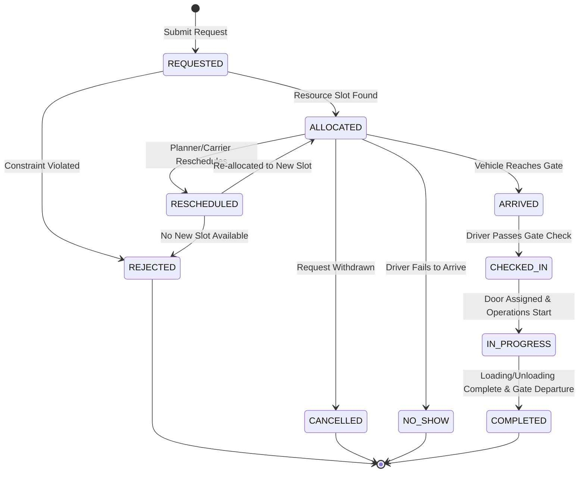

# Lifecycle & Event Sourcing Specification

---

## 1. Appointment State Transition Graph

Appointments follow a formal Finite State Machine (FSM). State mutations are strictly prohibited from occurring via arbitrary in-place column updates; all mutations occur via append-only event log insertion, with current-state projections dynamically updated or replayed from the stream.



---

## 2. Permitted State Transitions Table

| Current State | Permitted Event Trigger | Target State | Required Actors | Guard Condition |
| :--- | :--- | :--- | :--- | :--- |
| `NONE` | `APPT_REQUESTED` | `REQUESTED` | `SUPPLIER`, `CARRIER`, `PLANNER` | Valid facility, window start < window end, non-zero pallets. |
| `REQUESTED` | `APPT_ALLOCATED` | `ALLOCATED` | `SCHEDULER_ENGINE` | All business rules (BR-FAC-001 through BR-LAB-003) satisfied. |
| `REQUESTED` | `APPT_REJECTED` | `REJECTED` | `SCHEDULER_ENGINE` | At least one hard constraint violated; structured rejection reason recorded. |
| `ALLOCATED` | `VEHICLE_ARRIVED` | `ARRIVED` | `GATE_SENSOR`, `DRIVER_APP` | Occurrence time within simulation window; vehicle ID matches. |
| `ALLOCATED` | `APPT_RESCHEDULED`| `RESCHEDULED`| `PLANNER`, `CARRIER` | New time window provided; old allocation unlocked. |
| `ALLOCATED` | `APPT_CANCELLED` | `CANCELLED` | `CARRIER`, `PLANNER` | Unlocks reserved dock, yard slot, and labor. |
| `ALLOCATED` | `APPT_NO_SHOW` | `NO_SHOW` | `SYSTEM` (Timeout) | $t_{\text{current}} > t_{\text{scheduled\_end}} + \text{GracePeriod}$ with no check-in event. |
| `ARRIVED` | `CHECKED_IN` | `CHECKED_IN` | `GATE_CLERK` | Gate documents verified; matches scheduled calendar day. |
| `CHECKED_IN` | `SERVICE_STARTED` | `IN_PROGRESS` | `WAREHOUSE_OPERATOR` | Dock door physically secured; forklift operator assigned. |
| `IN_PROGRESS` | `SERVICE_COMPLETED`| `IN_PROGRESS` | `WAREHOUSE_OPERATOR` | Bill of Lading (BOL) signed; inspection completed. |
| `IN_PROGRESS` | `VEHICLE_DEPARTED`| `COMPLETED` | `GATE_CLERK` | Gate pass validated; dock and yard slot released to resource pool. |

---

## 3. Append-Only Event Schema (`CHECK_IN_EVENT`)

Every event record is immutable once persisted.

| Column Name | Type | Constraints | Description |
| :--- | :--- | :--- | :--- |
| `event_id` | `VARCHAR(64)` | `PRIMARY KEY` | Deterministic ID: `CHECK-{appointment_id}-{seq:02d}` |
| `appointment_id` | `VARCHAR(32)` | `FOREIGN KEY`, `NOT NULL`, `INDEX` | Root aggregate identifier. |
| `sequence_number` | `INTEGER` | `NOT NULL` | Monotonically increasing sequence per appointment ($1, 2, 3, \dots$). |
| `event_type` | `VARCHAR(32)` | `NOT NULL` | Standard lifecycle enumeration string. |
| `occurrence_time` | `TIMESTAMP` | `NOT NULL`, `INDEX` | Physical time when the real-world operational event occurred. |
| `recorded_time` | `TIMESTAMP` | `NOT NULL` | System ingestion time (differentiates late data arrival). |
| `actor` | `VARCHAR(32)` | `NOT NULL` | Initiator (`SYSTEM`, `CARRIER`, `GATE_CLERK`, etc.). |
| `payload_json` | `TEXT` | `NOT NULL` | Canonical JSON string containing context attributes. |

---

## 4. Deterministic Ordering and Tie-Breaking

When sorting or replaying events across multiple entities or simultaneous occurrences:
$$\text{Sort Order} = (\text{occurrence\_time ASC}, \text{sequence\_number ASC}, \text{appointment\_id ASC}, \text{event\_id ASC})$$

This multi-tiered deterministic comparator guarantees:
1. No reliance on database physical rowid order.
2. Identical event processing ordering across SQLite, PostgreSQL, and pandas dataframes.
3. Stable state reconstruction regardless of query execution plans.

---

## 5. Rebuildable Projections (Read Model)

The `Appointment` entity functions as a high-performance **materialized read projection**.

### Projection Reconstruction Algorithm:
```python
def rebuild_appointment_projection(events: list[CheckInEvent]) -> Appointment:
    # 1. Sort events by canonical comparator
    sorted_events = sorted(events, key=lambda e: (e.occurrence_time, e.sequence_number, e.event_id))
    
    # 2. Replay each event against state transition reducer
    projection = Appointment(appointment_id=events[0].appointment_id, status=AppointmentStatus.REQUESTED)
    for event in sorted_events:
        projection.apply(event)
        
    return projection
```

If the `Appointment` read table is dropped or corrupted, calling `rebuild_projections()` restores the exact current state from the authoritative `CHECK_IN_EVENT` stream.
